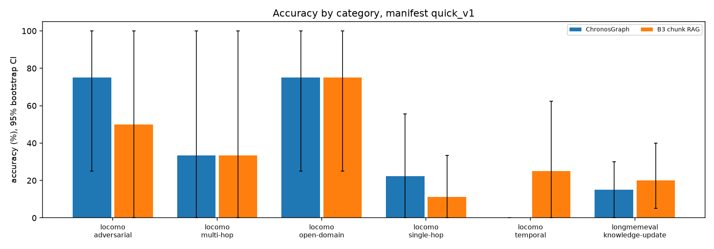

# Evaluation

> Generated by `make report` from `artifacts/`. Do not edit this file: edit `docs/templates/EVAL.tmpl.md`
> or the code that computes the numbers. No number below was typed by hand.

Results below come from: **quick_v1**: 96 answers from 2 systems, 96 scored, 48 questions in the manifest; judge calibration (Cohen's kappa) **not measured**; synthetic state probes: scripted.

## Headline

- **quick_v1**: ChronosGraph answers 25.0% [12.5, 37.5] n=48. Against B3 chunk RAG (27.1%, n=48 paired): no detectable difference (difference -2.1 points, 95% CI [-12.5, +8.3]).

Every interval is a 95% percentile bootstrap interval over questions (10,000 resamples).
A difference whose interval contains zero is written as "no detectable difference"; that is a statement
about this sample size, not evidence that the systems are equal. Every cell shows its `n`.

## Setup

| component | setting |
|---|---|
| system LLM | qwen2.5:7b-instruct-q4_K_M via Ollama (served as `chronos-qwen2.5-7b-32k`), temperature 0, context 32768 tokens |
| embeddings | BAAI/bge-small-en-v1.5 (sentence-transformers, mps) |
| entailment (runtime verifier) | cross-encoder/nli-deberta-v3-base, threshold 0.5 |
| judge (evaluation only) | openai/gpt-oss-120b, pooled over groq and cerebras, reasoning effort low |
| context budget | 1500 tokens (Qwen2.5 tokenizer) unless a table says otherwise |
| bootstrap | 10,000 resamples over questions, 95% percentile intervals, seed fixed |

All systems answer through the same generator, the same verifier and the same answer schema, and are
shown context in the same turn-tagged format `[turn_uid | date | speaker] text` under the same budget of
1500 tokens, except B2 (the whole history). Baselines get no answerability gate and no
query-type hint; ChronosGraph's rule-based query analysis is part of the system. Only LongMemEval
questions carry an asker hint (the user), for every system alike.

### Systems

| system | what it is | status |
|---|---|---|
| ChronosGraph | Full system: bi-temporal state, hybrid retrieval, answerability gate, entailment-checked citations. | run |
| B1 sliding window | Most recent turns that fit the budget. | not run yet |
| B2 full context | The whole history in the prompt (LoCoMo conversations that fit the window only). | not run yet |
| B3 chunk RAG | Three-turn chunks, bge-small embeddings, top chunks until the budget is full. | run |
| B4 turns + notes | Dense + BM25 over raw turns and over dated fact notes (the extracted memories with no status, versions or temporal filter). The strongest simple baseline. | not run yet |
| B5 append-only | ChronosGraph over a store where nothing is ever superseded: every non-retracted memory stays current. | not run yet |
| B6 mem0 | mem0 (open source) as an external reference point. Not run: its memories carry no turn provenance, so the shared turn-citation verifier would drop every claim; a fair run needs a verifier exemption the other systems do not get. | not run yet |

B4 is the comparison that matters most: it has the same extracted facts as ChronosGraph and none of the
state machinery, so any gap between them is what bi-temporal state buys.

## Manifests

Seeded, with dataset checksums inside each manifest (`eval/manifests/`). LongMemEval histories are reduced
to 24,000 Qwen2.5 tokens with a fixed seed (42); every evidence session is kept.

#### quick_v1

| dataset/category | n questions |
|---|---|
| locomo/adversarial | 4 |
| locomo/multi-hop | 3 |
| locomo/open-domain | 4 |
| locomo/single-hop | 9 |
| locomo/temporal | 8 |
| longmemeval/knowledge-update | 20 |
| **total** | 48 |

## Main results

Accuracy: unanswerable questions (LoCoMo category five, LongMemEval `_abs`) are correct iff the system
abstained; answerable ones are scored by exact normalized match, otherwise by the pooled judge with
LongMemEval's released answer-checking prompts. Abstaining on an answerable question is wrong.

#### quick_v1

| system | accuracy [95% CI] | token F1 (n) | abstention precision | abstention recall | abstention F1 | false abstention |
|---|---|---|---|---|---|---|
| ChronosGraph | 25.0% [12.5, 37.5] n=48 | 0.059 (n=43) | 12.5% [2.9, 25.0] n=32 | 80.0% [33.3, 100.0] n=5 | 21.6% [5.6, 39.0] n=48 | 65.1% [50.0, 79.1] n=43 |
| B3 chunk RAG | 27.1% [14.6, 39.6] n=48 | 0.077 (n=43) | 10.7% [0.0, 23.3] n=28 | 60.0% [0.0, 100.0] n=5 | 18.2% [0.0, 35.9] n=48 | 58.1% [43.2, 73.2] n=43 |



### By category

#### quick_v1

| system | locomo/adversarial | locomo/multi-hop | locomo/open-domain | locomo/single-hop | locomo/temporal | longmemeval/knowledge-update | overall |
|---|---|---|---|---|---|---|---|
| ChronosGraph | 75.0% [25.0, 100.0] n=4 | 33.3% [0.0, 100.0] n=3 | 75.0% [25.0, 100.0] n=4 | 22.2% [0.0, 55.6] n=9 | 0.0% [0.0, 0.0] n=8 | 15.0% [0.0, 30.0] n=20 | 25.0% [12.5, 37.5] n=48 |
| B3 chunk RAG | 50.0% [0.0, 100.0] n=4 | 33.3% [0.0, 100.0] n=3 | 75.0% [25.0, 100.0] n=4 | 11.1% [0.0, 33.3] n=9 | 25.0% [0.0, 62.5] n=8 | 20.0% [5.0, 40.0] n=20 | 27.1% [14.6, 39.6] n=48 |

### Paired comparisons

ChronosGraph minus each baseline on the questions both answered, with a paired bootstrap interval and an
exact McNemar test on the discordant pairs.

#### quick_v1

| pair | n paired | acc A | acc B | difference [95% CI] | only A / only B correct | McNemar p | verdict |
|---|---|---|---|---|---|---|---|
| ChronosGraph vs B3 chunk RAG | 48 | 25.0% | 27.1% | -2.1 pts [-12.5, +8.3] | 3 / 4 | 1.000 | no detectable difference |

### Systems that could not answer

#### quick_v1

_No system skipped a question._

## Citations

Precision, recall and F1 compare cited turns with gold evidence turns (LoCoMo `dia_id` via `source_ref`;
LongMemEval `has_answer` turns, also at session level) over answerable questions that have gold evidence;
an answer that cites nothing scores zero. Citation validity (cited turns exist and were in the context) is
true by construction, because the verifier drops every other citation; it is reported only to say so.
The support rate is the share of generated claims that passed the NLI check in the first verification
round, before any repair.

#### quick_v1

| system | turn precision | turn recall | turn F1 | session F1 | citation validity (true by construction) | citation support rate (NLI, first round) | gold evidence in context |
|---|---|---|---|---|---|---|---|
| ChronosGraph | 25.6% [14.0, 39.5] n=43 | 18.6% [9.3, 29.1] n=43 | 20.9% [10.8, 32.6] n=43 | 22.1% [11.6, 33.7] n=43 | 100.0% [100.0, 100.0] n=20 | 85.0% [66.7, 100.0] n=20 | 55.0% [42.2, 67.8] n=43 |
| B3 chunk RAG | 37.2% [23.3, 51.2] n=43 | 28.7% [17.1, 41.5] n=43 | 31.4% [19.4, 44.6] n=43 | 34.5% [22.1, 47.7] n=43 | 100.0% [100.0, 100.0] n=21 | 80.0% [64.0, 96.0] n=25 | 57.8% [45.7, 69.4] n=43 |

### NLI against a second opinion

#### quick_v1

Agreement between the NLI verdict and a gpt-oss-120b re-check on 41 sampled claims: 85.4% (95% CI [73.2, 95.1], n=41), kappa -0.08.

| outcome | n claims |
|---|---|
| NLI supported, judge supports | 35 |
| NLI supported, judge does not | 3 |
| NLI rejected, judge supports | 3 |
| NLI rejected, judge rejects | 0 |

## Cost

Prompt tokens are Qwen2.5-tokenized chat prompts. Latency replays each LLM call at the latency it was
recorded with, so a rerun from the cache reports the original cost.

#### quick_v1

| system | prompt tokens, answer call | prompt tokens, all calls | context tokens | latency p50 (s) | latency p95 (s) |
|---|---|---|---|---|---|
| ChronosGraph | 2105 (n=35) | 3332 (n=48) | 1474 (n=48) | 23.2 (n=48) | 33.2 (n=48) |
| B3 chunk RAG | 2124 (n=48) | 2358 (n=48) | 1458 (n=48) | 12.7 (n=48) | 21.3 (n=48) |

### Ingestion

#### quick_v1

| dataset | conversations | sessions | turns | wall time per conversation | LLM tokens per conversation (prompt / completion) | LLM calls per conversation |
|---|---|---|---|---|---|---|
| locomo | 1 | 30 | 568 | 49 min (n=1) | 427,080 / 49,353 (n=1) | 323.0 (n=1) |
| longmemeval | 20 | 260 | 2219 | 7 min (n=20) | 58,586 / 7,398 (n=20) | 49.4 (n=20) |

## Ablations

Every ablation reuses the ingested databases and the cached extraction; the state variants replay the
recorded classifier decisions under another write policy and make no new model call.

### A. Retrieval

#### quick_v1

Retrieval ablation. Which retrieval stages carry the accuracy? Questions: 12 questions (locomo/multi-hop, locomo/single-hop).

| variant | accuracy [95% CI] | gold evidence in context | context tokens | vs reference |
|---|---|---|---|---|
| plus_episodic | 25.0% [0.0, 50.0] n=12 | 20.8% [0.0, 45.8] n=12 | 1472 (n=12) | reference |

### B. State model (headline)

#### quick_v1

State-model ablation. Does bi-temporal state beat arrival-order supersession and an append-only store? Questions: 20 questions (longmemeval/knowledge-update).

| variant | accuracy [95% CI] | gold evidence in context | context tokens | vs reference |
|---|---|---|---|---|
| bitemporal | 15.0% [0.0, 30.0] n=20 | 73.7% [60.5, 86.8] n=19 | 1477 (n=20) | reference |

#### Synthetic probes

**Synthetic** (hand-written probes, extractor mode `scripted`, not a benchmark result). strict = every expected memory with its interval; current value = which value is current.

| case | append_only | arrival_order | bitemporal |
|---|---|---|---|
| in_session_correction | 5/5 strict, 5/5 current value | 5/5 strict, 5/5 current value | 5/5 strict, 5/5 current value |
| late_mention | 5/5 strict, 5/5 current value | 0/5 strict, 5/5 current value | 5/5 strict, 5/5 current value |
| neg_polarity | 0/5 strict, 0/5 current value | 5/5 strict, 5/5 current value | 5/5 strict, 5/5 current value |
| out_of_order_dates | 0/5 strict, 0/5 current value | 0/5 strict, 0/5 current value | 5/5 strict, 5/5 current value |
| temporary_vs_move | 3/5 strict, 3/5 current value | 3/5 strict, 5/5 current value | 5/5 strict, 5/5 current value |
| update_across_sessions | 0/5 strict, 0/5 current value | 0/5 strict, 5/5 current value | 5/5 strict, 5/5 current value |
| **all** | 13/30 strict, 13/30 current value | 13/30 strict, 25/30 current value | 30/30 strict, 30/30 current value |

### C. Answerability gate

#### quick_v1

Answerability gate ablation. What does each gate level buy in abstention quality, and what does it cost in false abstentions? Questions: 48 questions (locomo/adversarial, locomo/multi-hop, locomo/open-domain, locomo/single-hop, locomo/temporal, longmemeval/knowledge-update).

| gate | abstained on LoCoMo adversarial | abstained on LongMemEval _abs | false abstention on answerable | accuracy (all questions) |
|---|---|---|---|---|
| full | 75.0% [25.0, 100.0] n=4 | 100.0% [100.0, 100.0] n=1 | 65.1% [51.2, 79.1] n=43 | 25.0% [12.5, 37.5] n=48 |

### D. Context budget

#### quick_v1

Context budget ablation. How does accuracy scale with the context budget? Questions: 48 questions (locomo/adversarial, locomo/multi-hop, locomo/open-domain, locomo/single-hop, locomo/temporal, longmemeval/knowledge-update).

| variant | accuracy [95% CI] | gold evidence in context | context tokens | vs reference |
|---|---|---|---|---|
| tokens_1500 | 25.0% [12.5, 37.5] n=48 | 55.0% [42.2, 67.8] n=43 | 1474 (n=48) | reference |

_Not measured: the budget ablation has not run._

## Judge agreement

#### quick_v1

| scored by | n answers |
|---|---|
| flag | 63 |
| judge | 33 |

| judge provider | n judged answers |
|---|---|
| groq | 33 |

_Not measured: needs two providers; only ['groq'] available (not configured: ['cerebras'])._

Hand-audit sheet: `artifacts/judge_audit.csv`, 33 sampled verdicts, 0 labelled so far.

## Error analysis

Seven failure modes, each found by a fixed rule over the raw outputs (see `eval/failure_modes.py`). A
count is a number of candidates a human should read, not a verdict.

#### quick_v1

#### cross attribute contradiction

Rule: two current (ACTIVE, open) memories of one subject in the same context assert different places, under different attribute keys. Found **0** among 48 contexts.

_No instance in the evaluated sample._

#### attribute mismatch

Rule: a memory's attribute key has no lexical support in its own fact text (a key chosen for the wrong reason). Found **12** among 211 distinct memories shown in contexts.

- question `031748ae`: 'How many engineers do I lead when I just started my new role as Senior Software Engineer? How many engineers do I lead now?'; fact: 'The user is currently a Senior Software Engineer.'; key: 'job_title'; gold 'When you just started your new role as Senior Software Engineer, you led 4 engineers. Now, you lead 5 engineers', answered 'You lead five engineers now.'

- question `5c40ec5b`: 'How many times have I met up with Alex from Germany?'; fact: 'User has a friend Alex from Germany.'; key: 'relationship_status'; gold "We've met up twice.", answered "I don't know."

#### temporary stay

Rule: a current residence memory whose text is a trip, visit or short stay. Found **0** among 48 contexts.

_No instance in the evaluated sample._

#### temporal resolution

Rule: answerable, answered, judged wrong, with all gold evidence turns in the context, on a question about time. Found **3** among 15 answered questions.

- question `locomo:conv-50:q0014`: 'When did Calvin meet with the creative team for his new album?'; gold '8 June, 2023', answered 'Calvin met with the creative team for his new album on 2023-06-09.'

- question `locomo:conv-50:q0026`: 'When did Calvin record a podcast with his friends?'; gold '21 August, 2023', answered 'Calvin recorded a podcast with his friends on 2023-08-22.'

#### entity split

Rule: one name, several non-speaker entities in one conversation (under-merging). Found **1** among 21 conversations.

- name: 'alex'; entities: 2; descriptors: ['{"anchor": "user", "relation": "founder of a startup in edtech space", "text": null}', '{"anchor": "user", "relation": "founder", "text": null}']

#### over abstention

Rule: an answerable question the system declined. Found **28** among 43 answerable questions.

- question `184da446`: "How many pages of 'A Short History of Nearly Everything' have I read so far?"; abstained_at: 'model'; reason: 'The context does not provide information about the exact number of pages read so far.'; gold_in_context: True; gold '220', answered "I don't know."

- question `1cea1afa`: 'How many Instagram followers do I currently have?'; abstained_at: 'model'; reason: 'The context does not provide the current number of Instagram followers.'; gold_in_context: True; gold '600', answered "I don't know."

#### nli error

Rule: the NLI verdict on a sampled claim disagrees with the gpt-oss-120b re-check. Found **6** among 41 re-checked claims.

- claim: 'The user is currently working on weathering effects for their Ford F-150 pickup truck model.'; premise: "On 2023-05-26, assistant said: Applying decals can be a bit finicky, but with some guidance, you'll be able to achieve professional-looking results on your Ford F-150 pickup truck model. Here are some tips on how to apply decals correctly, including on curved surfaces:\n\n**Preparation is key**\n\n1. **Clean the surface**: Ensure the area where you'll be applying the decal is free of dust, oils, and dirt. Gently wipe the area with a soft brush or a lint-free cloth.\n2. **Choose the right decals**: Select decals specifically designed for model cars and suitable for your model's scale (1/25 in your case). Make sure the decals are not too thick or too thin, as this can affect their conformability.\n3. **Use a decal setting solution**: A decal setting solution (e.g., Micro Set or Mr. Mark Setter) can help the decal conform to curved surfaces and reduce the risk of bubbles or wrinkles.\n\n**Applying decals on flat surfaces**\n\n1. **Cut out the decal**: Use a sharp hobby knife or scissors to carefully cut out the decal from the sheet, leaving a small border around the design.\n2. **Soak the decal**: Soak the decal in warm water for about 30 seconds to loosen the adhesive.\n3. **Apply the decal**: Use a pair of tweezers to carefully place the decal onto the model, positioning it as desired. Use a credit card or a similar tool to gently smooth out any air bubbles or wrinkles.\n4. **Set the decal**: Apply a small amount of decal setting solution to the decal, following the manufacturer's instructions. This will help the decal conform to the surface.\n\n**Applying decals on curved surfaces**\n\n1. **Cut the decal into smaller pieces**: If the decal is large or complex, consider cutting it into smaller pieces to make it easier to apply on curved surfaces.\n2. **Use a decal application tool**: A decal application tool (e.g., a decal applicator or a curved decal scraper) can help you apply decals on curved surfaces. These tools provide extra pressure and control to conform the decal to the surface.\n3. **Apply the decal in sections**: Apply the decal in small sections, starting from the center and working your way outwards. Use a gentle, sweeping motion to smooth out the decal as you go.\n4. **Use a hair dryer or warm air**: Gently apply warm air to the decal using a hair dryer or a warm air blower to help it conform to the curved surface.\n\n**Additional tips**\n\n1. **Work patiently**: Applying decals can be a time-consuming process, especially on curved surfaces. Take your time, and work patiently to avoid mistakes.\n2. **Use a reference image**: Study reference images of the real car to ensure accurate placement and orientation of the decals.\n3. **Apply decals before clear coating**: Apply decals before clear coating your model to prevent the decals from lifting or becoming distorted.\n4. **Test the decals**: Test the decals on a scrap piece of plastic or a test model before applying them to your Ford F-150 pickup truck model.\n\nBy following these tips, you should be able to achieve professional-looking decals on your Ford F-150 pickup truck model, even on curved surfaces. Good luck, and have fun! On 2023-05-26, user said: Now that I have the airbrushing and decal application techniques down, I'd like to ask about weathering effects. I've seen some amazing weathered models that look incredibly realistic. How do I achieve that weathered look on my Ford F-150 pickup truck model? On 2023-05-26, assistant said: Weathering is an art form in itself, and it can elevate your model to a whole new level of realism. Achieving a weathered look on your Ford F-150 pickup truck model requires some practice, patience, and the right techniques. Here are some tips to help you get started:\n\n**Understanding weathering**\n\nWeathering is the process of simulating the effects of wear and tear, environmental conditions, and aging on a model. It's essential to study reference images of real vehicles to understand the types of weathering effects you want to achieve.\n\n**Basic weathering techniques**\n\n1. **Dust and dirt**: Use a small brush to apply a mixture of acrylic paint and thinner (or a weathering powder) to create a subtle, dusty appearance. Focus on areas that would naturally accumulate dirt, such as wheel wells, door handles, and the underside of the model.\n2. **Mud and grime**: Use a thicker mixture of paint and thinner to create a more pronounced, muddy appearance. Apply this mixture to areas that would be exposed to mud, such as the wheels, tires, and lower body panels.\n3. **Rust and corrosion**: Use a rust-colored paint or a rust-effect solution to simulate corrosion on metal surfaces. Apply this to areas that would be prone to rust, such as the undercarriage, suspension components, and exhaust system.\n4. **Fading and sun bleaching**: Use a lighter shade of the base color to create a faded, sun-bleached appearance on surfaces exposed to direct sunlight. Apply this effect to areas such as the hood, roof, and trunk lid.\n5. **Chipping and peeling**: Use a small brush to apply a lighter shade of paint to create a chipped or peeling effect on surfaces that would naturally wear off, such as the edges of body panels and trim.\n\n**Advanced weathering techniques**\n\n1. **Washes**: Use a thinned mixture of paint and thinner to create a subtle, translucent wash effect. Apply this to recessed areas, such as panel lines, to create depth and shading.\n2. **Drybrushing**: Use a almost-dry brush to apply a lighter shade of paint to raised surfaces, creating a textured, worn appearance.\n3. **Salt weathering**: Apply a mixture of salt and water to the model, then use a hair dryer to dry the mixture. The salt will create a textured, rough appearance when brushed off.\n4. **Oil stains and streaks**: Use a small brush to apply a dark, thinned mixture of paint to create oil stains and streaks on surfaces that would be exposed to oil, such as the engine and transmission areas.\n\n**Tips and tricks**\n\n1. **Start with a clean model**: Make sure your model is free of dust and oils before applying weathering effects.\n2. **Use reference images**: Study reference images of real vehicles to understand the types of weathering effects you want to achieve.\n3. **Work in layers**: Apply weathering effects in layers, starting with subtle, general effects and building up to more pronounced, specific effects.\n4. **Blend, blend, blend**: Use a soft brush to blend weathering effects, creating a natural, subtle appearance.\n5. **Practice, practice, practice**: Weathering is an art form that requires practice to master. Don't be discouraged if your first attempts don't turn out as expected.\n\nBy mastering these weathering techniques, you'll be able to achieve a realistically weathered look on your Ford F-150 pickup truck model. Remember to study reference images, practice patience, and work in layers to create a believable, worn appearance. Good luck, and have fun!"; kind: 'NLI failed, judge disagrees'; nli_entailment: 0.001864871349263993

- claim: "Based on your pre-approval amount of $350,000 and the purchase price of $325,000, I'll provide you with a more detailed estimate of your closing costs."; premise: "On 2023-08-11, assistant said: Congratulations on your pre-approval!\n\nBased on your pre-approval amount of $350,000 and the purchase price of $325,000, I'll provide you with a more detailed estimate of your closing costs.\n\nAssuming you're getting a conventional loan from Wells Fargo, here's a breakdown of the estimated closing costs:\n\n1. **Title Insurance and Escrow Fees**:\n\t* Title insurance: 0.5% to 1.0% of the purchase price = $1,625 to $3,250\n\t* Escrow fees: $500 to $2,000 = $1,250 (avg.)\n\tTotal: $2,875 to $5,250\n2. **Loan Origination Fees**:\n\t* Origination fee: 0.5% to 1.0% of the loan amount = $1,750 to $3,500\n\t* Underwriting fee: $300 to $900 = $600 (avg.)\n\t* Appraisal fee: $300 to $1,000 = $650 (avg.)\n\tTotal: $2,700 to $5,050\n3. **Appraisal Fee** (already included in loan origination fees above)\n4. **Credit Report Fee**:\n\t* $15 to $30 = $22.50 (avg.)\n5. **Flood Determination Fee**:\n\t* $15 to $50 = $32.50 (avg.)\n6. **Inspection Fees** (optional):\n\t* Home inspection: $300 to $1,000 = $650 (avg.)\n\t* Pest inspection: $50 to $150 = $100 (avg.)\n\t* Septic inspection: $100 to $300 = $200 (avg.)\n\tTotal: $950 to $1,350\n7. **Attorney Fees** (optional):\n\t* $500 to $2,000 = $1,250 (avg.)\n8. **Recording Fees**:\n\t* $50 to $200 = $125 (avg.)\n9. **Transfer Taxes** (varies by state and locality):\n\t* 0.1% to 2.0% of the purchase price = $325 to $6,500 (avg. 0.5% = $1,625)\n10. **Other Fees**:\n\t* Courier fees: $20 to $100 = $60 (avg.)\n\t* Notary fees: $20 to $100 = $60 (avg.)\n\nTotal Estimated Closing Costs: $11,332 to $20,322\n\nAs a rough estimate, you can expect to pay around 3.5% to 6.2% of the purchase price in closing costs. Based on your purchase price of $325,000, that would be:\n\n* 3.5%: $11,375\n* 6.2%: $20,150\n\nKeep in mind that these are estimated ranges, and your actual closing costs may vary depending on your location, loan terms, and other factors. It's always a good idea to review your loan estimate and closing disclosure documents carefully to get a more accurate estimate of your closing costs.\n\nI hope this helps you plan your budget for your new home purchase!"; kind: 'NLI failed, judge disagrees'; nli_entailment: 0.02013882278192216

## Limitations

- The generator is a seven-billion-parameter model quantized to four bits, running locally; absolute
  accuracy is not comparable with published numbers from larger models.
- LongMemEval histories are reduced to 24,000 tokens, so the benchmark's retrieval difficulty is
  lower than in the full setting.
- Sample sizes (small samples give wide intervals; read the `n` in each cell):

- `quick_v1`: 28 locomo questions, 20 longmemeval questions (48 in all)

- The judge is a single model family; the calibration above says whether the two providers agree, and
  the hand-audit sheet exists so a human can check a random sample of verdicts.
- Baselines have no answerability gate, so abstention comparisons mix the gate with the state model; the
  gate ablation separates them for ChronosGraph.
- The NLI model reads at most a few hundred tokens of premise; long cited turns are truncated.
- Extraction quality is not independently audited here; `scripts/audit_facts.py` samples memories for a
  human to label.

## Reproducing

```
make eval-quick     # ingest, answer, judge and report on the quick manifest
make eval-50        # 50 questions, every system and ablation (reuses the quick ingestion)
make eval-full      # everything, including ablations (long: schedule it overnight)
make report         # rebuild every table and figure from artifacts/, no API call
```
