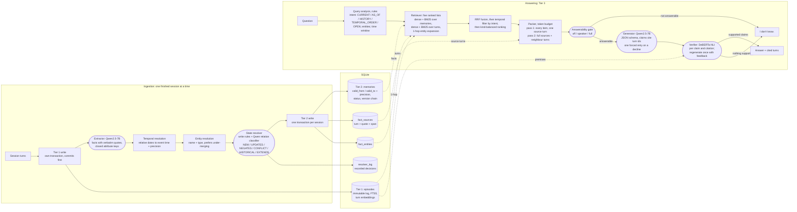

# Design

> Generated by `make report`; the architecture text is extracted from `SPEC.md`, the examples are real
> ingestions run by the report script, and the failure modes are mined from the evaluation outputs.

ChronosGraph is a local, persistent memory for multi-session conversational agents. It remembers what was
said, when it was true in the world, and when the system learned it, and it answers only with claims that a
cited turn entails.

## Architecture

The current pipeline, as implemented (ingestion on the left, answering on the right; local models in
rounded boxes, SQLite tables in cylinders):



{{spec_overview}}

### Tier one and two: the schema

{{spec_schema}}

### Ingestion

{{spec_ingestion}}

### Tier three: retrieval and answering

{{spec_tier3}}

## Why an episodic log plus versioned facts, and not a full graph

The source of truth is an append-only log of turns. Everything else is derived from it and can be rebuilt.
Facts are rows with intervals, a status and a version chain, each tied to the exact turn and quote that
support it.

- A graph store would add entity-relationship edges, but the questions in these benchmarks are mostly
  answered by a fact about one person at one time. What goes wrong in practice is not the lack of edges;
  it is deciding which of several statements about the same attribute is current. A versioned fact table
  makes that decision explicit, auditable and cheap.
- Edges would also multiply the places an extraction error can hide. A row with a quote can be read and
  checked by a person in seconds; a path through a graph cannot.
- One-hop expansion through the fact-to-entity link table gives the part of a graph that retrieval needs
  (what else is linked to this person) without a graph database.
- The log is immutable (triggers forbid updates and deletes), so a wrong fact can be retracted and
  explained but never silently rewritten. Provenance is a real foreign key, not a list inside a column.

The cost is honest: no multi-hop traversal beyond one step, and relations between entities are recorded
only as mentions, not as typed edges.

## Bi-temporal rules

Two clocks. Event time is when something was true in the world (`valid_from`, `valid_to`, `event_date`),
with a precision (day, week, month, year, session, before, unknown). Transaction time is when the system
learned it (the session and turn at which a row was recorded or retired). The write rules compare event
time at the coarser of the two precisions and fall back to arrival order only when event time cannot
decide.

{{spec_write_rules}}

Examples, produced by ingesting the repository's probes with scripted extractor outputs (so they show the
write rules, not a model's mistakes):

{{bitemporal_examples}}

A closed attribute vocabulary is what makes supersession reliable: a fact either maps to a single-valued key
such as residence or employer, in which case candidates are looked up by key, or it does not and is
multi-valued. Without the key, deciding that "moved to Seattle" replaces "lives in Austin" rests on
embedding similarity alone.

## Provenance and verification

Every memory has at least one source row naming a turn, a verbatim quote and the character span of that
quote in the turn. At answer time the generator must cite turn ids from the context it was shown. The
verifier then checks, per claim and per citation: the turn exists, it was in this query's packed context
(recorded in the answer log before generation), and an NLI model finds the claim entailed by the
concatenated cited turns at or above a threshold ({{nli_threshold}}). Failing citations are dropped; if a claim
loses all of them the answer is regenerated once with feedback naming the unsupported claims; claims still
unsupported are removed; if none remain the system abstains. Whatever is returned is therefore supported
by turns that were in front of the model.

This is evidence that the answer is grounded in the cited text, not proof that the cited text is true, and
the NLI model is itself fallible (see the claim re-check in the evaluation).

## Planned change: separate what is selected from what the model reads (HLD)

**Status: proposed, not implemented, not measured.** Nothing in the evaluation tables reflects it yet.
Step one below (kind-balanced ranking) is implemented; the rest is design.

### Problem

Diagnosis of the eval-50 outputs and of the dev conversation (LoCoMo conv-26, never used for the reported
numbers) located the loss of answerable questions in the generator, not in storage or retrieval:

- The generator declines answerable questions even when a turn that answers them is in the context, in
  every system, and most often in ChronosGraph.
- Replaying those declines with the same model showed that it answers from the gold line alone, or from a
  baseline's plain-turn context, but declines on ChronosGraph's context. Showing raw turn lines without
  the question-type line recovered the most answers; stripping memory metadata alone recovered none.
- Re-asking with an instruction to answer, or on a subset of lines the model itself picked, rescued very
  few: at temperature zero the same context gives the same decision.
- Retrieval ranked memories above turns because three of the five ranked lists hold memories, so
  turns that ranked first in both turn lists were packed out of the budget.

The stored state is not the problem: the bi-temporal store is what passes the synthetic state probes that
the append-only and arrival-order policies fail. The problem is handing that state to a
seven-billion-parameter model in its raw structured form (memory ids, status, intervals, source lists,
and question-type rules).

### Principle

Keep the memories for **selection and resolution**; show the model mostly **turns**. ChronosGraph decides
what goes in the context and what is current; the model reads evidence in the format it handles best,
with state stated in plain words only where it changes the answer.

### Architecture

```
question
  │
  ▼
query analysis (rules)            intent, entities, time window            unchanged
  │
  ▼
retrieval ── dense + BM25 over memories and turns, 1-hop entity expansion, RRF
  │           then temporal filter by intent
  │           then kind-balanced ranking (memory, turn, memory, ...)         step one, implemented
  ▼
resolution ── for each selected memory: version chain, conflict set, status   new layer
  │            → a StateNote per source turn, only when state matters:
  │              superseded, conflicted, retracted (history questions), resolved date
  ▼
presentation ── evidence as turn lines, grouped by subject, in time order      new renderer
  │              "[turn_uid | date | speaker] text"
  │              "    note: no longer true from <date>; replaced by [turn_uid]"
  │              fact text shown only when no source turn fits the budget
  ▼
answerability gate ── reads the same rendering                              unchanged logic
  ▼
generator ── same schema; prompt without the QUESTION TYPE rule table;      prompt change
  │           one plain sentence when the intent needs it
  │           ("The question asks about <period>.")
  ▼
verifier ── NLI per cited turn, unchanged; cited turns are mapped back to   unchanged
            memories through fact_sources for the answer log
```

### Components

| component | change | why |
|---|---|---|
| Retriever | kind-balanced ranking after fusion and the temporal filter (`balance_kinds`) | turns were buried under memories, which appear in more lists |
| Resolver (new, read-only) | turns each selected memory's chain, conflict set and status into short notes attached to its source turns | keeps the state signal without memory-line syntax |
| Packer / renderer | a `presentation` setting: `structured` (today) or `turns` (new); same budget, same clipping of long turns | the model answered from plain turns and declined on structured lines |
| Generator prompt | drop the QUESTION TYPE rule table; keep one plain sentence for time-scoped questions; keep the citation rules | the rule table pushed a small model towards declining |
| Gate | unchanged logic, fed the new rendering | the gate and the generator must judge the same evidence |
| Verifier and answer log | unchanged; the model cites turns only, memory ids are recovered from `fact_sources` | provenance stays a foreign key, not a model output |

### What does not change

The episodic log, the fact store, the write rules, the state policies, the answer schema shared by all
systems, the token budget, the NLI threshold, and the baselines. Baselines already show plain turns, so
after this change ChronosGraph differs from B4 only in what it selects and in the state notes, which is the
comparison the evaluation is meant to make.

### Evaluation plan

1. Develop on dev_v1 only: compare `structured` and `turns` presentation with the same retrieval on the
   rate of declines given the gold turn shown, the gold-in-context rate, abstention on adversarial
   questions, and the scripted state probes.
2. Proceed to eval-50 only if declines given gold shown fall clearly, adversarial abstention does not
   fall, and the state probes still pass.
3. Report `presentation` as an ablation next to the gate and budget ablations, so the effect of the
   format is measured, not assumed.

### Risks

- **State signal lost.** If notes are too terse, knowledge-update questions regress towards B5. Watch
  the LongMemEval knowledge-update category and the state probes; the notes are the mitigation.
- **Over-answering.** A model that declines less may also answer unanswerable questions. Adversarial
  abstention is a gating metric; the answerability gate stays on.
- **Budget.** Turns are longer than fact lines, so fewer items fit. Long turns keep the current clipping
  around their supporting quote.
- **Model ceiling.** If declines persist with plain turns, the limit is the generator model, and the
  remaining lever is a stronger local model, reported as such rather than tuned around.

## Related work

- **Zep / Graphiti** already maintains a temporal knowledge graph with bi-temporal edges. ChronosGraph's
  bi-temporal facts are not new relative to it.
- **Mem0** already extracts facts and updates them (add, update, delete, no-op) as new information
  arrives. Updating a stored fact is not new either.
- **MemGPT / Letta** manage tiers of memory for an agent; the three-tier split here is in the same spirit
  and differs in what each tier stores.
- **LoCoMo** and **LongMemEval** are the benchmarks used; both are used here as released, with
  LongMemEval's answer-checking prompts.

What this project adds, and what it should be judged on: turn-level citations that are checked by an
entailment model before an answer is returned; a closed attribute vocabulary used to make supersession
reliable; and a complete pipeline that runs locally on a seven-billion-parameter model on a laptop. It has
not been compared with Zep or Mem0 end to end except where the evaluation says so.

## Failure modes

Mined from the evaluation outputs by fixed rules; each count is a population of candidates to read, and the
examples are the first two by question id.

{{error_analysis}}

What each mode means for the design: cross-attribute contradictions and attribute mismatches come from the
extractor choosing the wrong key, which the closed vocabulary reduces but a seven-billion-parameter model
does not eliminate; temporary stays are a prompt and ontology problem (the NOT-list helps, it does not
solve it); temporal resolution errors are mostly the model's arithmetic on relative dates or an event
time attached to the wrong fact; entity splits are the price of preferring under-merging; over-abstention
is the price of a gate that refuses when unsure; and NLI errors are why the claim re-check exists.
